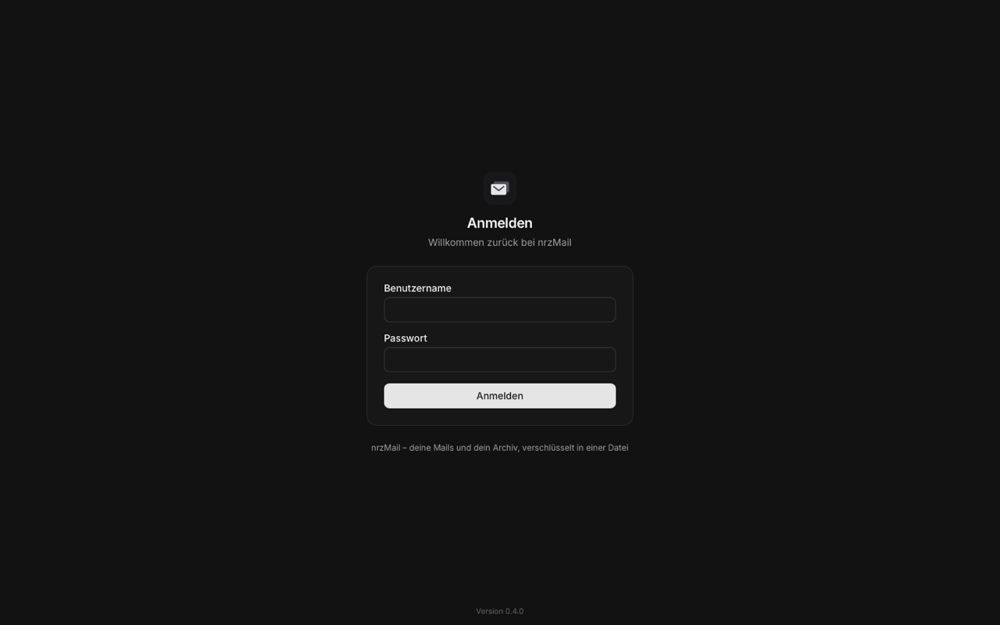

# nrzMail

**English** — A Rust-powered email client.

**Deutsch** — Ein in Rust geschriebener E-Mail-Client.

**Español** — Un cliente de correo escrito en Rust.

## macOS

`scripts/macos.sh` → `dist-macos/nrzMail.app` + DMG. Milchglas-Fenster wie nrzX. Beim ersten Start mit dem nrzMail-Server verbinden (empfohlen, z. B. `http://umbrel.local:8360` – Mails und Postfächer kommen vom Server, Anmeldung wird gemerkt) oder ohne Server lokal verwenden (eigener Server im Prozess, Daten in `~/Library/Application Support/nrzMail/local`). Umschalten im Menü **nrzMail**.
